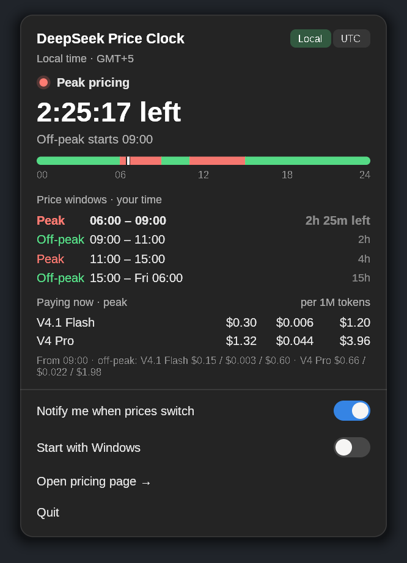
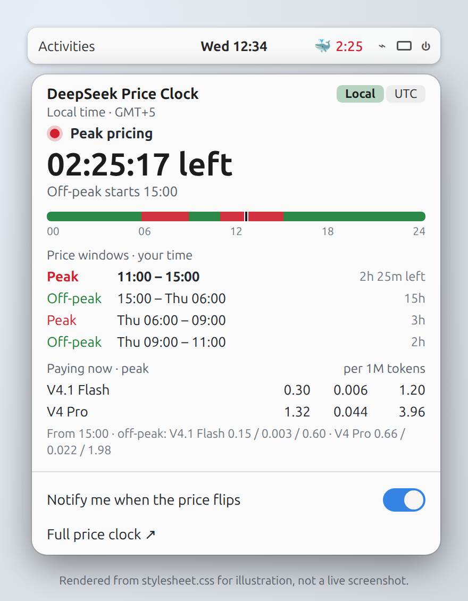
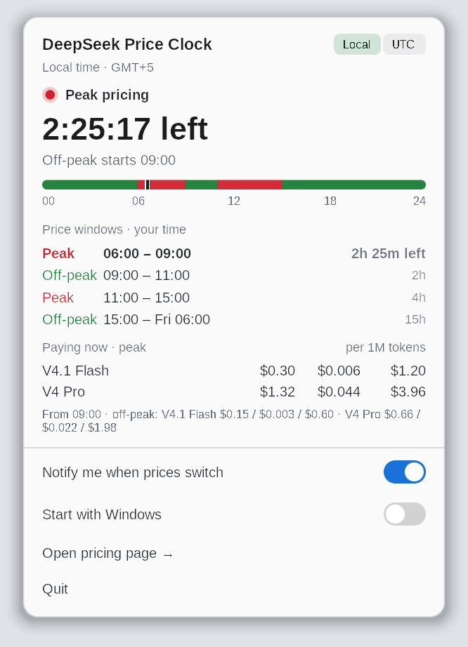

# DeepSeek Price Clock

A GNOME Shell extension and a Windows 11 tray clock for DeepSeek's peak and
off-peak API pricing — the same rules and the same clock on both.

DeepSeek charges roughly half price when it is off-peak. This keeps that fact in
sight: a whale and a countdown in the GNOME top bar, or a green/red dot in the
Windows notification area that opens the same clock as a card. Green means
off-peak, red means peak, and both show how long is left.

**Jump to:** [Previews](#previews) · [What it shows](#what-it-shows) ·
[Install](#install) · [Windows 11](#windows-11) ·
[Pricing rules](#pricing-rules-implemented) · [Tests](#tests) · [Files](#files)

> **Credit:** all of the pricing logic, the peak/off-peak window model, the weekend
> and Chinese-holiday rules and the rate table come from **[@deepakness](https://github.com/deepakness)**'s
> browser extension [deepakness/deepseek-price-clock](https://github.com/deepakness/deepseek-price-clock).
> That project is the original work; this repo is only a GNOME Shell port of it,
> released under the same MIT licence with his copyright notice kept in
> [`LICENSE`](LICENSE).

## Previews

<table>
  <tr>
    <td align="center" width="50%">
      <br>
      <sub><b>GNOME Shell</b> · dark</sub>
    </td>
    <td align="center" width="50%">
      <br>
      <sub><b>Windows 11</b> · dark</sub>
    </td>
  </tr>
  <tr>
    <td align="center">
      <br>
      <sub><b>GNOME Shell</b> · light</sub>
    </td>
    <td align="center">
      <br>
      <sub><b>Windows 11</b> · light</sub>
    </td>
  </tr>
</table>

*Rendered from this repo's own styling and drawing code — `stylesheet.css` for
GNOME and `windows/rust/src/paint.rs` for Windows — not live screenshots. Both
follow the system theme. The Windows renders use the build machine's fallback
typeface; on Windows the card is drawn in Segoe UI.*

## What it shows

**GNOME** puts the clock in the top bar: `🐳 3:12` counting down to the next
flip, and `12:45` once under an hour. **Windows** has no supported way to put live
text in the taskbar, so the dot's tooltip carries the countdown and clicking the
dot opens the card.

**Click the indicator or the dot** for:

- current state badge with a status dot, and a live `h:mm:ss` countdown
- when the next window opens, in Local or UTC (toggle in the header)
- a 24-hour timeline of peak/off-peak segments with a "now" marker
- the current price window and the next three, with durations
- current per-1M-token rates for V4.1 Flash and V4 Pro, plus the rates that start
  at the flip
- a switch for notifications when the price flips
- a link to the upstream price clock

On Windows the card adds a **Start with Windows** switch and **Quit**, and
remembers the notification and Local/UTC choices between sessions.

## Install

From a release bundle, no clone needed:

```bash
gnome-extensions install --force deepseek-price-clock@e4crypt3d.github.io.shell-extension.zip
```

Or from source:

```bash
git clone https://github.com/E4crypt3d/deepseek-price-clock-gnome.git
cd deepseek-price-clock-gnome
./install.sh
```

Then **log out and back in**. GNOME only scans the extensions directory at login,
so a hand-installed extension cannot be hot-loaded. It is already enabled, so it
appears at the right end of the top bar after the login.

Requirements: GNOME Shell 45–51 with `glib-compile-schemas` and `gnome-extensions`
(part of `glib2`/`gnome-shell`). Tested on Ubuntu with GNOME Shell 50.1 on Wayland.

Update after `git pull`: re-run `./install.sh` and log out and back in again.

## Windows 11

The same clock runs from the [`windows/`](windows/) folder. There are two builds:
the native `DeepSeekPriceClock.exe` (a small Rust program that draws the card) and
a PowerShell 5.1 fallback that runs on the .NET Framework that ships with Windows.
Both read the same rules and show the same dot; the native build is the one with
the card above, and the PowerShell fallback keeps the simpler tray menu.

No installer, no admin rights, no service, no dependencies. Each release attaches
`DeepSeekPriceClock.exe` on its own, and also ships it alongside the PowerShell
build and the tests in `deepseek-price-clock-windows.zip`.

```powershell
# the whole install: run the exe
.\DeepSeekPriceClock.exe

# or the fallback, from the zip or the repo
powershell -NoProfile -ExecutionPolicy Bypass -File .\windows\install.ps1 -StartNow
```

Use **Start with Windows** in the card to have it come back at login, and **Quit**
to stop it. Only one copy runs at a time, and the dot comes back if Explorer
restarts. Windows 11 hides new tray icons in the overflow chevron until you drag
the dot onto the taskbar.

The card follows the Windows app theme, light or dark, and is per-monitor DPI
aware. See [`windows/README.md`](windows/README.md) for the details, the preview
command and the test commands.

## Light and dark

Both platforms follow the system theme: GNOME uses the shell's light or dark
variant, Windows uses the app theme. Colors switch automatically when you change
it, and live if you flip it while the popup is open. The panel keeps a green/red
countdown with enough contrast on either theme, and the timeline and its "now"
marker are drawn in the matching palette. The Windows card has its own light and
dark palettes rather than inheriting a menu style.

## Pricing rules implemented

These mirror DeepSeek's billing windows and the upstream extension exactly:

- Peak windows are fixed **UTC** times: **01:00–04:00** and **06:00–10:00**
  (09:00–12:00 and 14:00–18:00 Beijing time). Everything else is off-peak.
- Since **2026-08-23 00:00 Beijing**, the split only applies **Monday–Friday
  Beijing time**. Saturdays and Sundays are off-peak all day.
- Chinese public holidays are off-peak all day. The calendar is the State
  Council's yearly arrangement, stored as Beijing dates in `CN_HOLIDAYS` in
  `price.js`: 2026 Mid-Autumn/National Day and the full 2027 list
  (国办发明电〔2026〕10号).
- Make-up workdays (weekend days that become working days, e.g. 2027-01-31,
  2027-02-14, 2027-05-08, 2027-09-26, 2027-10-09) are treated as weekends and
  billed off-peak, same as upstream. DeepSeek's docs describe peak pricing as
  Monday–Friday, so this is the expected reading, but it is not modelled
  separately.

Each year the State Council publishes the next year's arrangement in early
November. Add the dates to `CN_HOLIDAYS` in `price.js`, then re-run
`./install.sh`. The Windows pricing modules have their own copy of the same list.

## Tests

The GNOME pricing logic has no shell dependencies, so it runs under plain Node:

```bash
npm test
```

`tests/price.test.mjs` covers the switch instants to the millisecond, the
weekend-rule start, every 2027 holiday plus the days around them, the
`nextSwitch`/`currentWindowStart`/`windowList` invariants the menu relies on,
and the 24-hour bar across half-hour, negative and beyond-12h UTC offsets, plus
a year of hourly samples asserting every reported flip is real.

The Windows side has its own suites: the Rust pricing module (`cargo test --lib`,
which also covers the timeline and window-list helpers the card uses) and 42
PowerShell checks. Both sweep 17,520 hourly instants over 2026 and 2027 and
assert every reported flip is real, matching `price.js`. See
[`windows/README.md`](windows/README.md) for the commands.

## Releases

Every push that touches the extension code on `main` runs
`.github/workflows/release.yml`. It first runs each platform's tests on its own
runner: the GNOME extension on Ubuntu and the Windows clock on Windows. Only if
both pass does it work out the next version from the existing `v*` tags, build
the bundle, check it contains `metadata.json` at the root and the compiled
schema, package the native `.exe` and the PowerShell scripts as well, then create
the tag and a GitHub release with both zip files attached. The first release is
`v1.0.0`.

Manual releases, for a minor or major bump, run the workflow from the Actions
tab with `bump` (or an exact `version`). Add `[skip release]` to a commit
message to land code without cutting a release.

## Notifications

The extension notifies you when pricing flips, at most once per flip, and only
if the flip was noticed within five minutes (so waking a sleeping laptop does not
fire a stale alert). The switch is in the menu; the setting is stored in GSettings
under `org.gnome.shell.extensions.deepseek-price-clock` (`notify`, `timezone`).

The Windows card has the same notification switch, shown as a normal toast, and
stores it under `HKCU\Software\DeepSeekPriceClock`.

## Files

| File | Purpose |
| --- | --- |
| `extension.js` | panel button, menu, countdown timer, timeline drawing, notifications |
| `price.js` | pricing logic: windows, weekend/holiday rules, rate table |
| `stylesheet.css` | menu and panel styling |
| `schemas/*.gschema.xml` | GSettings schema (`notify`, `timezone`, `last-kind`) |
| `install.sh` | copies the files into `~/.local/share/gnome-shell/extensions/` |
| `tests/price.test.mjs` | edge-case tests for the pricing logic (`npm test`) |
| `docs/` | HTML/CSS source of the GNOME previews, and the rendered images above |
| `windows/` | the Windows 11 clock: native Rust tray app with the card, PowerShell fallback, and their own tests |

## Uninstall

```bash
gnome-extensions disable deepseek-price-clock@e4crypt3d.github.io
rm -rf ~/.local/share/gnome-shell/extensions/deepseek-price-clock@e4crypt3d.github.io
```

Windows: **Quit** from the card, then delete the `.exe`. If you used
`install.ps1`, also run `install.ps1 -Uninstall` to remove the Startup shortcut.

## Credits

This extension exists because of **[deepakness](https://github.com/deepakness)**, who
wrote [deepseek-price-clock](https://github.com/deepakness/deepseek-price-clock) for
Chrome and Firefox. The peak/off-peak windows, the August 2026 weekday-only rule, the
holiday handling, the countdown and flip-notification behaviour, and the per-model
rates in `price.js` were all taken from that project. See it first, and star it.

- Original extension and pricing logic: [deepakness/deepseek-price-clock](https://github.com/deepakness/deepseek-price-clock), MIT © 2026 deepakness.
- GNOME Shell port, menu, timeline and Windows card rendering: this repository.
- Holiday calendar: General Office of the State Council of the PRC.

Not affiliated with DeepSeek.
