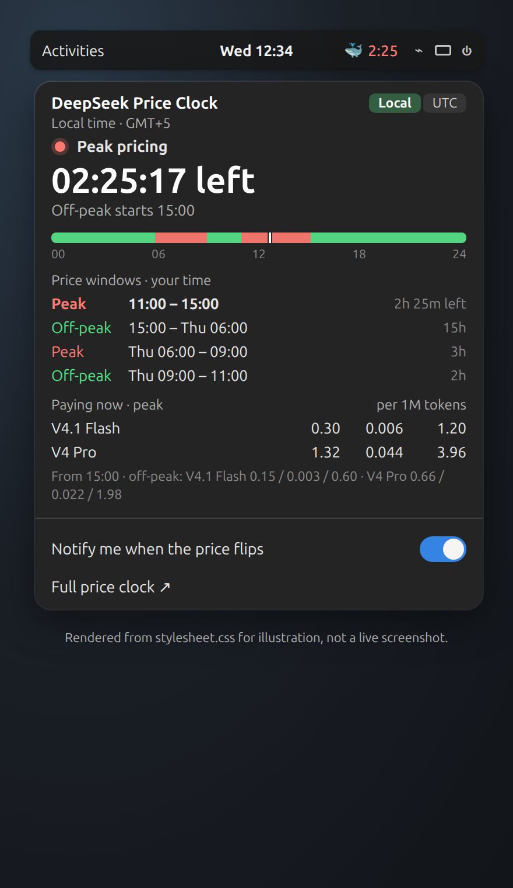

# DeepSeek Price Clock

A GNOME Shell extension and a Windows 11 tray clock for the same pricing rules.

DeepSeek's API is cheaper when it is off-peak (roughly half price). This puts that
fact in your top bar: a whale, a countdown to the next price flip, and the current
state in green (off-peak) or red (peak).

> **Credit:** all of the pricing logic, the peak/off-peak window model, the weekend
> and Chinese-holiday rules and the rate table come from **[@deepakness](https://github.com/deepakness)**'s
> browser extension [deepakness/deepseek-price-clock](https://github.com/deepakness/deepseek-price-clock).
> That project is the original work; this repo is only a GNOME Shell port of it,
> released under the same MIT licence with his copyright notice kept in
> [`LICENSE`](LICENSE).



*Rendered from `stylesheet.css` for illustration, not a live screenshot.*

## What it shows

**Top bar:** `🐳 3:12` counting down to the next flip; `12:45` once under an hour.
Green while off-peak, red while peak pricing is active.

**Click it** for:

- current state badge with a status dot, and a live `h:mm:ss` countdown
- when the next window opens, in Local or UTC (toggle in the header)
- a 24-hour timeline of peak/off-peak segments with a "now" marker
- the next four price windows with durations
- current per-1M-token rates for V4.1 Flash and V4 Pro, plus the rates that start at the flip
- an alert switch for notifications when the price flips
- a link to the upstream price clock

## Light and dark

The extension follows the shell: colors switch automatically when you change
GNOME's appearance, and live if you flip it while the extension is running.
The panel keeps a green/red countdown with enough contrast on either theme, and
the 24-hour timeline and its "now" marker are drawn in the matching palette.


*Rendered from `stylesheet.css` for illustration, not a live screenshot.*

## Install

From a release bundle, no clone needed:

```bash
gnome-extensions install --force deepseek-price-clock@e4crypt3d.github.io.shell-extension.zip
```

Or from source:

```bash
git clone https://github.com/E4crypt3d/deepseek-price-clock-gnome.git
cd deepseek-price-clock-gnome
./install.sh
```

Then **log out and back in**. GNOME only scans the extensions directory at login,
so a hand-installed extension cannot be hot-loaded. It is already enabled, so it
appears at the right end of the top bar after the login.

Requirements: GNOME Shell 45–51 with `glib-compile-schemas` and `gnome-extensions`
(part of `glib2`/`gnome-shell`). Tested on Ubuntu with GNOME Shell 50.1 on Wayland.

Update after `git pull`: re-run `./install.sh` and log out and back in again.

## Windows 11

The same clock runs on Windows 11 from the [`windows/`](windows/) folder: a tray
dot, green off-peak and red peak, with the countdown on hover and the schedule in
the menu. No installer, no service, no dependencies, just the PowerShell 5.1 that
ships with Windows. Releases include `deepseek-price-clock-windows.zip`.

```powershell
powershell -NoProfile -ExecutionPolicy Bypass -File .\windows\install.ps1 -StartNow
```

See [`windows/README.md`](windows/README.md) for the details and the test command.

The port's rules match `price.js` exactly: its tests compare 17,520 hourly
instants over 2026 and 2027 against the JavaScript implementation.

## Pricing rules implemented

These mirror DeepSeek's billing windows and the upstream extension exactly:

- Peak windows are fixed **UTC** times: **01:00–04:00** and **06:00–10:00**
  (09:00–12:00 and 14:00–18:00 Beijing time). Everything else is off-peak.
- Since **2026-08-23 00:00 Beijing**, the split only applies **Monday–Friday
  Beijing time**. Saturdays and Sundays are off-peak all day.
- Chinese public holidays are off-peak all day. The calendar is the State
  Council's yearly arrangement, stored as Beijing dates in `CN_HOLIDAYS` in
  `price.js`: 2026 Mid-Autumn/National Day and the full 2027 list
  (国办发明电〔2026〕10号).
- Make-up workdays (weekend days that become working days, e.g. 2027-01-31,
  2027-02-14, 2027-05-08, 2027-09-26, 2027-10-09) are treated as weekends and
  billed off-peak, same as upstream. DeepSeek's docs describe peak pricing as
  Monday–Friday, so this is the expected reading, but it is not modelled
  separately.

Each year the State Council publishes the next year's arrangement in early
November. Add the dates to `CN_HOLIDAYS` in `price.js`, then re-run `./install.sh`.

## Releases

Every push that touches the extension code on `main` runs
`.github/workflows/release.yml`, which works out the next version from the
existing `v*` tags, builds the bundle, checks it contains `metadata.json` at the
root and the compiled schema, packages the Windows scripts as well, then creates
the tag and a GitHub release with both zip files attached. The first release is `v1.0.0`.

Manual releases, for a minor or major bump, run the workflow from the Actions
tab with `bump` (or an exact `version`). Add `[skip release]` to a commit
message to land code without cutting a release.

## Tests

The pricing logic has no GNOME dependencies, so it runs under plain Node:

```bash
npm test
```

`tests/price.test.mjs` covers the switch instants to the millisecond, the
weekend-rule start, every 2027 holiday plus the days around them, the
`nextSwitch`/`currentWindowStart`/`windowList` invariants the menu relies on,
and the 24-hour bar across half-hour, negative and beyond-12h UTC offsets, plus
a year of hourly samples asserting every reported flip is real.

## Notifications

The extension notifies you when pricing flips, at most once per flip, and only
if the flip was noticed within five minutes (so waking a sleeping laptop does not
fire a stale alert). The switch is in the menu; the setting is stored in GSettings
under `org.gnome.shell.extensions.deepseek-price-clock` (`notify`, `timezone`).

## Files

| File | Purpose |
| --- | --- |
| `extension.js` | panel button, menu, countdown timer, timeline drawing, notifications |
| `price.js` | pricing logic: windows, weekend/holiday rules, rate table |
| `stylesheet.css` | menu and panel styling |
| `schemas/*.gschema.xml` | GSettings schema (`notify`, `timezone`, `last-kind`) |
| `install.sh` | copies the files into `~/.local/share/gnome-shell/extensions/` |
| `tests/price.test.mjs` | edge-case tests for the pricing logic (`npm test`) |
| `docs/` | HTML/CSS source of the preview images above |
| `windows/` | the Windows 11 tray clock, self-contained, with its own tests |

## Uninstall

```bash
gnome-extensions disable deepseek-price-clock@e4crypt3d.github.io
rm -rf ~/.local/share/gnome-shell/extensions/deepseek-price-clock@e4crypt3d.github.io
```

## Credits

This extension exists because of **[deepakness](https://github.com/deepakness)**, who
wrote [deepseek-price-clock](https://github.com/deepakness/deepseek-price-clock) for
Chrome and Firefox. The peak/off-peak windows, the August 2026 weekday-only rule, the
holiday handling, the countdown and flip-notification behaviour, and the per-model
rates in `price.js` were all taken from that project. See it first, and star it.

- Original extension and pricing logic: [deepakness/deepseek-price-clock](https://github.com/deepakness/deepseek-price-clock), MIT © 2026 deepakness.
- GNOME Shell port, menu and timeline rendering: this repository.
- Holiday calendar: General Office of the State Council of the PRC.

Not affiliated with DeepSeek.
