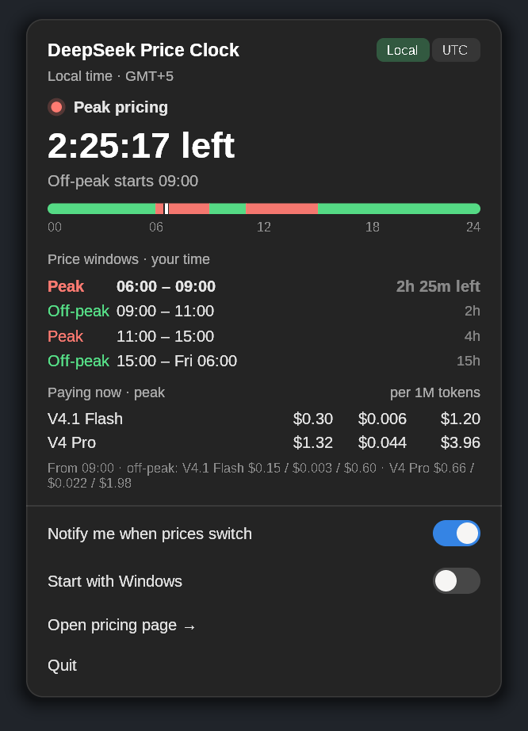
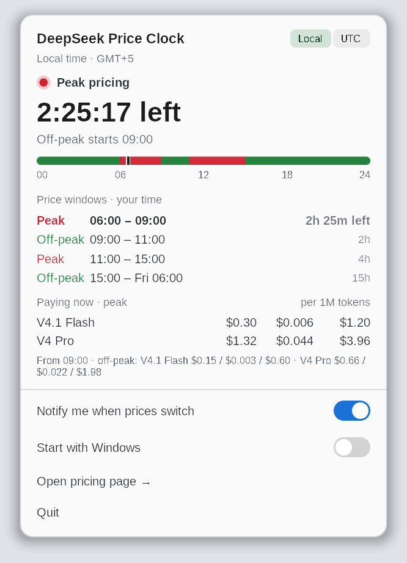

# DeepSeek Price Clock for Windows 11

The Windows 11 side of [deepseek-price-clock-gnome](https://github.com/E4crypt3d/deepseek-price-clock-gnome):
a tray dot that opens the same price clock the GNOME extension puts in the top
bar — a status dot, a live countdown, the 24-hour peak/off-peak timeline, the
next four windows and the current rates, in a rounded card that follows the
Windows light or dark app theme.

The dot is green when off-peak, red when peak. Hover it for the countdown, click
it for the card.



*Rendered by the app's own card renderer (`--preview`), not a mock-up. The
typeface in this image is the build machine's fallback; Windows uses Segoe UI.*

No installer, no admin rights, no dependencies, no background service. It ships
two ways: `DeepSeekPriceClock.exe`, a small native binary in `rust/`, and the
original PowerShell script that runs on the PowerShell 5.1 and .NET Framework
that ship with Windows 11. Both show the same dot and read the same rules. The
native build is the one with the card; the PowerShell fallback keeps the simpler
tray menu.

## Why a tray icon

Windows 11 has no supported way for a normal app to put a live widget in the
taskbar. Third-party widgets live in the Widgets board and require a packaged
MSIX app with Adaptive Cards, which is far heavier than this needs. The
notification area is the lightweight supported surface, so that is what this
uses. Notifications are raised as balloon tips, which Windows 11 shows as normal
toasts in the Action Center.

The card is drawn by the app itself (`rust/src/paint.rs`) rather than assembled
from Win32 menu items. That is what gives it the GNOME layout: real rounded
corners, a soft shadow, the segmented Local/UTC pill, the coloured timeline and
the switch toggles. It is a per-pixel translucent layered window, so it also
looks right on top of the taskbar or any wallpaper.

## Install

Download `DeepSeekPriceClock.exe` straight from the release page, or take the
release zip (which also carries the PowerShell build and the tests) and run:

```powershell
.\windows\DeepSeekPriceClock.exe
```

That is the whole install. Use **Start with Windows** in the card to have it come
back at login (a per-user `Run` value, no admin rights), and **Quit** to stop it.
The indicator re-adds itself if Explorer restarts, so it does not disappear for
the rest of the session. Both builds take the same single-instance lock, so at
login only one dot appears even if both autostarts were set, but pick one anyway.

Or use the PowerShell version, from a release zip or from the repo:

```powershell
# release zip: unpacks to a windows\ folder
Expand-Archive deepseek-price-clock-windows.zip -DestinationPath .
cd windows

# or from source
git clone https://github.com/E4crypt3d/deepseek-price-clock-gnome.git
cd deepseek-price-clock-gnome\windows

powershell -NoProfile -ExecutionPolicy Bypass -File .\install.ps1 -StartNow
```

That adds a shortcut to your Startup folder and starts the clock. To start it
without autostart:

```powershell
powershell -NoProfile -ExecutionPolicy Bypass -File .\DeepSeekPriceClock.ps1
```

`-ExecutionPolicy Bypass` is needed because the script is not code signed. It
does not change any system setting, it applies to that one process.

To remove the autostart entry:

```powershell
powershell -NoProfile -ExecutionPolicy Bypass -File .\install.ps1 -Uninstall
```

## Using it

- Click the dot, with either button, to open the card. Click the dot again,
  press **Esc**, or click anywhere else to close it.
- The dot is green off-peak and red peak; its tooltip carries the countdown.
- **Local / UTC** in the card header switches every time in the card, including
  the timeline. The choice is remembered.
- The big number is the time left in the current window. Under it is the day's
  timeline, with a line at the current minute.
- **Price windows** lists the current window and the next three, with the current
  one in bold, and the time left in it.
- **Paying now** gives the three current rates for each model; the line under it
  says what they become at the next flip.
- **Notify me when prices switch** and **Start with Windows** are switches. The
  notification choice is remembered; the autostart state is whatever the Run key
  says.
- **Open pricing page** opens DeepSeek's pricing docs, and **Quit** stops the
  clock.

The card follows the Windows app theme, light or dark, and switches live if you
change it. It is per-monitor DPI aware, so it stays crisp at 125 %, 150 % or any
other scaling.



Only one instance runs at a time, so autostart plus a manual start will not give
you two dots.

## Pricing rules

The same rules as the GNOME extension, ported from
[deepakness/deepseek-price-clock](https://github.com/deepakness/deepseek-price-clock):

- Peak windows are 01:00 to 04:00 and 06:00 to 10:00 UTC. Everything else is
  off-peak.
- Since 16:00 UTC on 22 August 2026, weekends and Chinese public holidays are
  off-peak all day. Before that date the split applied every day.
- Beijing time decides what counts as a weekend or holiday, which is why the
  dates in `PriceClock.ps1` are Beijing dates and the switch times are UTC.

The 2027 holiday dates come from the State Council notice published in November
2026. Add the next year's dates to `ChinaHolidays` when they are announced.

## Tests

```powershell
powershell -NoProfile -ExecutionPolicy Bypass -File .\tests\PriceClock.Tests.ps1
```

42 checks, no Pester needed: known instants either side of every boundary, the
weekend rule start, holiday stretches, window starts, the window list, countdown
formatting, plus a two year hourly invariant sweep.

The native build has its own tests. They share the pricing module with the app and
run on any platform, no Windows needed. They sweep 17,520 hourly instants over
2026 and 2027 and check every reported flip, and the timeline, window-list and
countdown helpers the card uses are covered there too.

```bash
cargo test --manifest-path windows/rust/Cargo.toml --lib
cargo build --release --target x86_64-pc-windows-gnu \
  --manifest-path windows/rust/Cargo.toml
```

The release workflow runs these Rust tests and the PowerShell suite on a Windows
runner, and the GNOME tests on Linux, before it builds the `.exe` into the
Windows zip.

The card can be rendered to BMP files without opening it, which is how the images
above were made; add `utc` or a scale as needed:

```powershell
.\DeepSeekPriceClock.exe --preview card.bmp 1795656883 1.5
```

That writes `card.bmp` (dark) and `card-light.bmp` (light).

## Files

| File | What it is |
| --- | --- |
| `DeepSeekPriceClock.exe` | The native tray app, built from `rust/` (in the release zip) |
| `DeepSeekPriceClock.ps1` | The PowerShell fallback: tray icon, menu, timer, notifications |
| `PriceClock.ps1` | Pricing rules and the autostart helpers, no UI |
| `install.ps1` | Adds or removes the Startup shortcut |
| `tests/PriceClock.Tests.ps1` | Logic tests |
| `rust/src/main.rs` | The native tray app: window, tray icon, timers, settings, placement |
| `rust/src/paint.rs` | The card: layout, rounded shapes, shadow, text, hit areas, themes |
| `rust/src/pricing.rs` | Pricing rules, timeline segments and window list, shared and tested |

## Notes

- Windows 11 puts new tray icons in the overflow chevron until you drag the dot
  onto the taskbar; after that it stays visible.
- The dot and the card are drawn in code in the native build, so the repo has no
  image assets.
- The tray timer fires every 20 seconds, which keeps the tooltip honest and
  catches a price flip promptly. The card has its own one second timer while it
  is open, so its countdown ticks live, and does no work once closed.
- Nothing leaves your machine and nothing is fetched from the network apart from
  the pricing page if you click it.

## Credits

Pricing logic and the peak/off-peak rules come from
[deepakness/deepseek-price-clock](https://github.com/deepakness/deepseek-price-clock),
MIT (c) 2026 deepakness. This is an independent Windows port, not affiliated
with DeepSeek.

## License

MIT, see [LICENSE](LICENSE).
